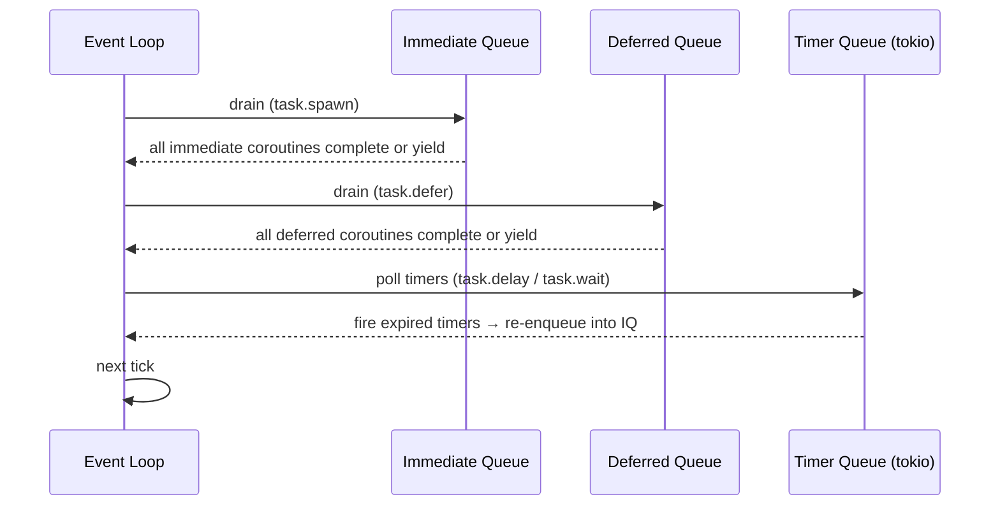

# 0002 — std:task — cooperative task scheduler

> [!WARNING]
> This RFC is `draft`. It is under refinement and is **not** the contract.

## Summary

Introduce `std:task` as the canonical cooperative scheduler for neoc. The module exposes the five primitives every Luau developer expects — `spawn`, `defer`, `delay`, `wait`, and `cancel` — matching the Roblox `task` library API surface exactly. Scheduling is backed by tokio's async runtime; coroutine yields never block an OS thread. The module is strictly intra-worker: it operates on coroutines within a single Lua VM, orthogonal to the cross-VM machinery in `std:thread`.

## Motivation

Luau developers have one mental model for concurrent code: the `task` library. Roblox ships it as a built-in global; Lune ships a 1:1 port; Lute ships one too. The API is not one option among many — for the Luau ecosystem it is the idiomatic concurrency primitive, the same way `goroutine` + `chan` is idiomatic Go and `Promise` + `async/await` is idiomatic JS.

Without `std:task`, neoc forces Luau developers to reason about raw coroutines and `os.clock`-based busy-waiting. That is not acceptable for a runtime targeting the Roblox/Lune ecosystem (issue #6 acceptance criteria). The gap also makes code written for Lune non-portable to neoc without rewriting every async call site.

`std:thread` already exists for OS-thread-level workers (it spawns separate Lua VMs). The cooperative scheduler is the missing complementary primitive: lightweight coroutine fan-out within a single VM, no OS-thread overhead, event-loop-integrated timing.

## Detailed design

### Design tenets

1. **Roblox compatibility is the north star.** The five-function API surface (`spawn`, `defer`, `delay`, `wait`, `cancel`) matches Roblox's `task` library exactly. Deviation requires a specific justification; "our own design" is not a justification.

2. **No OS-thread blocking.** Every yield suspends a Lua coroutine and parks a tokio future. The underlying OS thread is never stalled.

3. **Per-worker scheduler.** Each Lua VM (each `std:thread` worker) runs its own scheduler. There is no global cross-VM scheduler. This is consistent with how Roblox shards work: each RunService has its own scheduler.

4. **tokio drives timing.** `delay` and `wait` use `tokio::time::sleep`, not `os.clock` busy-loops.

5. **Error isolation.** An error inside a spawned coroutine does not propagate to the spawner (consistent with Roblox behaviour). The error is reported to stderr and the coroutine is cleaned up. The spawner continues.

### Lua surface

```lua
local task = require("std:task")

-- spawn: resume fn immediately on the current thread; runs until fn first yields or returns,
-- then control returns to the caller. Caller is NOT suspended.
-- Returns the coroutine (thread). Any extra args are passed to fn.
local t = task.spawn(function(x)
    print("runs now, x =", x)
end, 42)

-- defer: queue fn to resume after the current scheduler cycle completes.
-- Returns the coroutine (thread). Any extra args are passed to fn.
local t2 = task.defer(function()
    print("runs after this cycle")
end)

-- delay: schedule fn to resume after `secs` seconds (tokio-backed, not busy-wait).
-- Returns the coroutine (thread). Extra args after fn are forwarded to fn.
local t3 = task.delay(2.5, function()
    print("runs ~2.5s from now")
end)

-- wait: yield the *current* coroutine for `secs` seconds.
-- Must be called from a coroutine context; errors if called from the main thread.
-- Negative values are clamped to 0. Returns elapsed time as a float.
local elapsed = task.wait(1.0)

-- cancel: cancel a thread returned by spawn/defer/delay.
-- Returns true if successfully cancelled; false if already completed (no-op).
task.cancel(t3)
```

#### Argument passing

All three scheduling functions (`spawn`, `defer`, `delay`) accept variadic arguments after the function, forwarded to the function on resume. This matches Roblox behaviour:

```lua
task.spawn(function(a, b, c)
    print(a, b, c)   -- → 1  2  3
end, 1, 2, 3)
```

#### `task.wait` return value

`task.wait(secs)` returns the elapsed real time as a float. Callers may use this to compensate for scheduler jitter. Negative values for `secs` are clamped to `0` (Roblox-compatible); `task.wait(-1)` behaves identically to `task.wait(0)`.

```lua
local dt = task.wait(0.016)   -- target ~60 fps frame budget
```

#### Error behaviour

A coroutine that errors does not crash the scheduler. The error is reported via the runtime's standard error channel (same path as `std:io` error output) and the coroutine is dropped. Other in-flight coroutines are unaffected. This matches Roblox:

```lua
task.spawn(function()
    error("boom")
    -- ^ logged to stderr; other coroutines keep running
end)
task.wait(0.1)  -- yield to next tick; scheduler continues
```

### Scheduler semantics

The scheduler operates in two phases within each event-loop tick:

1. **Immediate queue** — coroutines enqueued by `spawn`. Drained in FIFO order before advancing the event loop.
2. **Deferred queue** — coroutines enqueued by `defer`. Drained after the immediate queue empties.

`delay` and `wait` are implemented as tokio `sleep` futures wired into the event loop; they do not participate in the immediate/deferred queues until their timer fires.



This two-phase model is the canonical Roblox scheduler design (Immediate → Deferred → Heartbeat → other signals). neoc collapses the Roblox heartbeat phases that have no meaning outside of a game engine, but preserves the Immediate/Deferred distinction because it is observable to Luau code.

### Thread handle

`task.spawn`, `task.defer`, and `task.delay` return a **thread handle** — a Lua `thread` (coroutine) value, not a custom userdata. This matches Roblox.

`task.spawn` and `task.defer` accept either a plain function **or** a coroutine created by `coroutine.create`, matching Roblox which accepts both forms. When a raw coroutine is passed, the scheduler registers it on entry.

Passing a coroutine in `dead` state (already run to completion) or `running` state (currently executing) is an error (consistent with Roblox). The error message is `"task.spawn: cannot schedule a dead coroutine"` or `"task.spawn: cannot schedule a running coroutine"` respectively; substitute `task.defer` for the function name when raised from that function.

`task.cancel` accepts any thread handle that was registered with the scheduler (i.e. returned from `spawn`/`defer`/`delay`). Passing a coroutine that was never handed to the scheduler is an error.

Return values: `true` if the coroutine was cancelled, `false` if it had already completed (Roblox-compatible). The `false` path is a no-op — it does not error.

```lua
-- Correct: t was returned by task.spawn
local t = task.spawn(f)
task.cancel(t)   -- → true

-- Also correct: handle from task.defer is equally cancellable
local t2 = task.defer(f)
task.cancel(t2)   -- → true

-- Also correct: pre-created coroutine passed to spawn (Roblox-compatible)
local c = coroutine.create(f)
local t3 = task.spawn(c)   -- scheduler registers c on entry; t3 == c
task.cancel(t3)   -- → true

-- No-op: already-completed thread returns false, does not error
local t4 = task.spawn(function() end)   -- completes immediately
local cancelled = task.cancel(t4)       -- → false

-- Error: raw coroutine never registered with the scheduler
local c2 = coroutine.create(f)
task.cancel(c2)   -- → error: "task.cancel: thread not registered with scheduler"
```

### Relationship to `std:thread`

| Dimension | `std:thread` | `std:task` |
|---|---|---|
| Concurrency model | OS-level workers (separate Lua VMs) | Cooperative coroutines (single VM) |
| Communication | `Channel` (`thread.parent`, message-passing) | Shared coroutine scheduler |
| Shared state | `Sendable` + spawn-time handoff | Local — no cross-coroutine state isolation needed |
| When to use | CPU-bound parallelism, isolation | I/O-bound concurrency, Roblox-style game loops |

### Rust-side layout

```
src/lua/std/
  task.rs    -- task.spawn, task.defer, task.delay, task.wait, task.cancel
              -- + Scheduler struct (immediate queue, deferred queue, tokio timer integration)
```

The `Scheduler` is held on the `Lua` VM state (via `set_app_data`) so it is per-VM without any global state. Each `task.*` function pulls the scheduler from the VM's app data, so it is never accessed across threads.

```rust
// src/lua/std/task.rs (sketch — not the implementation contract)

struct Scheduler {
    immediate: VecDeque<(mlua::Thread, Vec<mlua::Value>)>,
    deferred:  VecDeque<(mlua::Thread, Vec<mlua::Value>)>,
    // timer handles are owned by tokio and re-enqueue into `immediate` on fire
}
```

### Acceptance criteria

- [ ] `task.spawn(fn | thread, ...)` — resume fn (or raw coroutine) immediately; pass varargs; return thread handle.
- [ ] `task.defer(fn | thread, ...)` — queue fn (or raw coroutine) to end of cycle; pass varargs; return thread handle.
- [ ] `task.delay(secs, fn, ...)` — schedule fn after `secs` seconds (tokio-backed); pass varargs; return thread handle.
- [ ] `task.wait(secs)` — yield current coroutine for `secs` seconds; return elapsed float.
- [ ] `task.cancel(thread)` — cancel a scheduled thread; return `true` if cancelled, `false` if already completed (no-op); never errors for a registered completed thread.
- [ ] `task.cancel` on an unregistered coroutine errors with message `"task.cancel: thread not registered with scheduler"`.
- [ ] `task.spawn`/`task.defer` on a `dead` coroutine errors with message `"task.spawn: cannot schedule a dead coroutine"` (or `task.defer` variant).
- [ ] `task.spawn`/`task.defer` on a `running` coroutine errors with message `"task.spawn: cannot schedule a running coroutine"` (or `task.defer` variant).
- [ ] `task.wait` called from the main thread (outside a scheduler-managed coroutine) errors immediately.
- [ ] `task.wait` with a negative duration behaves identically to `task.wait(0)` (clamped to 0).
- [ ] `task.wait(0)` yields to the next event-loop tick and returns (behaves as in Roblox).
- [ ] Errors in spawned coroutines are isolated — logged, not propagated; other coroutines unaffected.
- [ ] Scheduler is per-VM; no global state.
- [ ] `task.wait` never blocks the OS thread (tokio sleep, not busy-wait).
- [ ] Argument passing verified by spec: varargs forwarded correctly for `spawn`, `defer`, and `delay`.
- [ ] Type definition stub (`.d.luau`) covers the full surface.
- [ ] Spec file lives at `tests/std/task.spec.luau`, uses `lib:test` (`describe`/`test`/`expect`), and is committed before the implementation PR opens (see [RFC 0000 — spec-driven development](0000-spec-driven-development.md) for format reference).
- [ ] Full test suite: happy path, cancellation, error isolation, timing accuracy, varargs, `wait` return value, negative-duration clamp, main-thread error, dead/running coroutine errors, `task.cancel` error string.
- [ ] Timing tests assert `elapsed >= requested`; upper-bound tolerance is 100ms (CI runner jitter budget), documented in the spec.
- [ ] `task.cancel` on a mid-execution (resumed but not yielded) coroutine marks it cancelled; the coroutine is not re-enqueued after its next yield. The cancellation is not immediate — the coroutine completes its current execution slice.

## Drawbacks

- **New module surface.** Five new exported functions to maintain. The API is stable (Roblox compatibility constrains it), but the underlying scheduler is non-trivial Rust.
- **Immediate/Deferred ordering observable to scripts.** Scripts that depend on `spawn` vs `defer` ordering are coupling themselves to scheduler internals. This is inherent to the Roblox model and is acceptable because it is explicitly documented.
- **No static thread budget.** There is no cap on the number of simultaneously live coroutines. A script can saturate the immediate queue. This is consistent with Roblox and Lune — we follow the pattern rather than diverge.

## Alternatives

### Do nothing / raw coroutines

Scripts can do `coroutine.create` + `coroutine.resume` today. This forces manual scheduling, manual error handling, and OS-clock polling for timers. It is the wrong default for a runtime targeting Luau developers. Rejected.

### `task.wait` as a blocking call (busy-wait)

Simpler to implement — `std::thread::sleep` in Rust. But it blocks the OS thread for the entire duration, killing the concurrency model. A server handling 100 coroutines each sleeping for 1s would serialise all 100 waits rather than overlapping them. Rejected on principle 1 (no surprises) and principle 2 (footgun).

### Single global scheduler across all VMs

Share one scheduler across all `std:thread` workers. Eliminates the per-worker scheduler overhead, but requires the scheduler to be `Send + Sync` and introduces lock contention across workers. The Roblox model explicitly does not share a scheduler across workers — each RunService is isolated. Rejected to stay consistent with the established per-worker mental model.

### Expose `desynchronize` / `synchronize` primitives (Roblox parallel Luau)

Roblox's parallel Luau model adds `task.desynchronize()` to yield out of the serialised actor context and `task.synchronize()` to re-enter it. This is meaningful in Roblox because actors have write-isolation enforced by the engine. neoc's multi-worker model uses `std:thread` (separate VMs) not actor isolation, so the `desynchronize`/`synchronize` pair maps to nothing meaningful. Excluded from this RFC; can be revisited if neoc ever introduces actor-style isolation.

### Combine with `std:thread`

Put `task.spawn` et al. directly onto the `std:thread` module. Rejected because the two concerns are distinct: `std:thread.spawn` creates a new VM; `task.spawn` schedules a coroutine inside the current VM. Mixing them on the same module object would blur the abstraction boundary and confuse users coming from Roblox (where `task` and `thread` are separate globals). The separation also keeps both modules independently comprehensible.

## Open questions

1. **What is the error format for a coroutine that throws?** The error message, the stack trace, the coroutine identity? This needs a consistent format across all runtime error surfaces. Track with the `std:io` error formatting work. **Cross-track dependency:** this RFC cannot pin the exact error string in the acceptance criteria until the std:io error formatting design is decided. The implementation PR must be gated on that design being settled (or a temporary format agreed and recorded in an ADR).

2. ~~**Should `task.wait(0)` be legal?**~~ **Resolved.** `task.wait(0)` is legal. It yields until the next event-loop tick, consistent with Roblox. The error-behaviour example has been updated to avoid depending on this while it was open; it is now a closed contract captured in the acceptance criteria.

3. ~~**Cancellation semantics for a running coroutine.**~~ **Resolved.**  on a coroutine that has been resumed and is mid-execution (not currently yielded): option (b) — mark it cancelled, let the next yield detect the flag and not re-enqueue. This avoids closing the coroutine mid-frame and is the safer approach. Captured in acceptance criteria.

## Implementation notes

- The Scheduler should be registered on the Lua VM via `lua.set_app_data(Scheduler::new())` during engine construction in `src/lua/sandbox.rs`.
- `task.wait` requires the calling coroutine to be running inside the scheduler; called from the main thread it errors immediately (the spec must cover this path).
- The tokio timer integration in `task.delay` and `task.wait` is the same pattern as the TCP accept loop in `std:net` — spawn a `tokio::task` that fires a wakeup into the Lua scheduler's queue. No new tokio primitives needed.
- Depends on the tokio runtime being available; the engine already requires it (see `sandbox.rs` `make_engine`).
- The `.d.luau` type stub should be placed in `types/std/task.d.luau` alongside the other module stubs.
