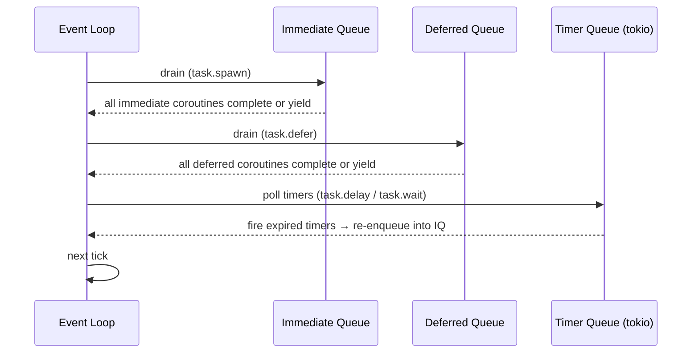

# 0002 — std:task — cooperative task scheduler

> [!WARNING]
> This RFC is `draft`. Under refinement — **not** the contract.

## Summary

`std:task` — canonical cooperative scheduler for neoc. Exposes five primitives matching Roblox `task` library exactly: `spawn`, `defer`, `delay`, `wait`, `cancel`. Backed by tokio async runtime; yields never block OS threads. Strictly intra-worker: operates on coroutines within a single Lua VM, orthogonal to cross-VM `std:thread`.

## Motivation

Luau ecosystem has one concurrency mental model: `task` library. Roblox ships it built-in; Lune ships a 1:1 port; Lute too. Not one option among many — the idiomatic primitive, like `goroutine`+`chan` for Go or `Promise`+`async/await` for JS.

Without `std:task`: raw coroutines + `os.clock` busy-waiting. Unacceptable for a runtime targeting Roblox/Lune ecosystem (issue #6). Breaks portability — Lune code requires rewriting every async call site.

`std:thread` handles OS-thread-level workers (separate Lua VMs). `std:task` is the complementary primitive: lightweight coroutine fan-out within a single VM, no OS-thread overhead, event-loop-integrated timing.

## Detailed design

### Design tenets

1. **Roblox compatibility is north star.** Five-function surface matches Roblox `task` exactly. Deviation requires specific justification; "our own design" is not one.
2. **No OS-thread blocking.** Every yield suspends a coroutine and parks a tokio future.
3. **Per-worker scheduler.** Each Lua VM runs its own scheduler. No global cross-VM scheduler.
4. **tokio drives timing.** `delay`/`wait` use `tokio::time::sleep`, not busy-loops.
5. **Error isolation.** Errors in spawned coroutines do not propagate to spawner. Reported to stderr, coroutine cleaned up.

### Lua surface

```lua
local task = require("std:task")

-- spawn: resume fn immediately on the current thread; runs until fn first yields or returns,
-- then control returns to the caller. Caller is NOT suspended.
-- Returns the coroutine (thread). Any extra args are passed to fn.
local t = task.spawn(function(x)
    print("runs now, x =", x)
end, 42)

-- defer: queue fn to resume after the current scheduler cycle completes.
-- Returns the coroutine (thread). Any extra args are passed to fn.
local t2 = task.defer(function()
    print("runs after this cycle")
end)

-- delay: schedule fn to resume after `secs` seconds (tokio-backed, not busy-wait).
-- Returns the coroutine (thread). Extra args after fn are forwarded to fn.
local t3 = task.delay(2.5, function()
    print("runs ~2.5s from now")
end)

-- wait: yield the *current* coroutine for `secs` seconds.
-- Must be called from a coroutine context; errors if called from the main thread.
-- Negative values are clamped to 0. Returns elapsed time as a float.
local elapsed = task.wait(1.0)

-- cancel: cancel a thread returned by spawn/defer/delay.
-- Returns true if successfully cancelled; false if already completed (no-op).
task.cancel(t3)
```

#### Argument passing

`spawn`, `defer`, `delay` accept variadic args after the function, forwarded on resume. Matches Roblox:

```lua
task.spawn(function(a, b, c)
    print(a, b, c)   -- → 1  2  3
end, 1, 2, 3)
```

#### `task.wait` return value

Returns elapsed real time as float. Callers may compensate for scheduler jitter. Negative `secs` clamped to `0` (Roblox-compatible); `task.wait(-1)` ≡ `task.wait(0)`.

```lua
local dt = task.wait(0.016)   -- target ~60 fps frame budget
```

#### Error behaviour

Coroutine errors do not crash scheduler. Error reported via runtime error channel (same path as `std:io`), coroutine dropped. Other in-flight coroutines unaffected. Matches Roblox:

```lua
task.spawn(function()
    error("boom")
    -- ^ logged to stderr; other coroutines keep running
end)
task.wait(0.1)  -- yield to next tick; scheduler continues
```

### Scheduler semantics

Two phases per event-loop tick:

1. **Immediate queue** — `spawn` coroutines. Drained FIFO before advancing event loop.
2. **Deferred queue** — `defer` coroutines. Drained after immediate queue empties.

`delay`/`wait` → tokio `sleep` futures wired into event loop; do not participate in immediate/deferred queues until timer fires.



Canonical Roblox scheduler design (Immediate → Deferred → Heartbeat → signals). neoc collapses heartbeat phases (no meaning outside game engine) but preserves Immediate/Deferred distinction — observable to Luau code.

### Thread handle

`task.spawn`, `task.defer`, `task.delay` return a Lua `thread` (coroutine) value, not custom userdata. Matches Roblox.

`task.spawn`/`task.defer` accept plain function **or** `coroutine.create`-produced coroutine. When raw coroutine passed → scheduler registers on entry.

Passing `dead` or `running` coroutine → error:
- `"task.spawn: cannot schedule a dead coroutine"`
- `"task.spawn: cannot schedule a running coroutine"`
- Substitute `task.defer` when raised from that function.

`task.cancel` accepts any thread handle registered with scheduler (returned from `spawn`/`defer`/`delay`). Unregistered coroutine → error.

Returns: `true` if cancelled, `false` if already completed (no-op, no error).

```lua
-- Correct: t was returned by task.spawn
local t = task.spawn(f)
task.cancel(t)   -- → true

-- Also correct: handle from task.defer is equally cancellable
local t2 = task.defer(f)
task.cancel(t2)   -- → true

-- Also correct: pre-created coroutine passed to spawn (Roblox-compatible)
local c = coroutine.create(f)
local t3 = task.spawn(c)   -- scheduler registers c on entry; t3 == c
task.cancel(t3)   -- → true

-- No-op: already-completed thread returns false, does not error
local t4 = task.spawn(function() end)   -- completes immediately
local cancelled = task.cancel(t4)       -- → false

-- Error: raw coroutine never registered with the scheduler
local c2 = coroutine.create(f)
task.cancel(c2)   -- → error: "task.cancel: thread not registered with scheduler"
```

### Relationship to `std:thread`

| Dimension | `std:thread` | `std:task` |
|---|---|---|
| Concurrency model | OS-level workers (separate Lua VMs) | Cooperative coroutines (single VM) |
| Communication | `Channel` (`thread.parent`, message-passing) | Shared coroutine scheduler |
| Shared state | `Sendable` + spawn-time handoff | Local — no cross-coroutine isolation needed |
| When to use | CPU-bound parallelism, isolation | I/O-bound concurrency, Roblox-style game loops |

### Rust-side layout

```
src/lua/std/
  task.rs    -- task.spawn, task.defer, task.delay, task.wait, task.cancel
              -- + Scheduler struct (immediate queue, deferred queue, tokio timer integration)
```

`Scheduler` held on Lua VM state via `set_app_data` → per-VM, no global state. Each `task.*` pulls scheduler from VM app data, never accessed across threads.

```rust
// src/lua/std/task.rs (sketch — not the implementation contract)

struct Scheduler {
    immediate: VecDeque<(mlua::Thread, Vec<mlua::Value>)>,
    deferred:  VecDeque<(mlua::Thread, Vec<mlua::Value>)>,
    // timer handles are owned by tokio and re-enqueue into `immediate` on fire
}
```

### Acceptance criteria

- [ ] `task.spawn(fn | thread, ...)` — resume immediately; pass varargs; return thread handle.
- [ ] `task.defer(fn | thread, ...)` — queue to end of cycle; pass varargs; return thread handle.
- [ ] `task.delay(secs, fn, ...)` — schedule after `secs` (tokio-backed); pass varargs; return thread handle.
- [ ] `task.wait(secs)` — yield current coroutine for `secs`; return elapsed float.
- [ ] `task.cancel(thread)` — return `true` if cancelled, `false` if completed (no-op); never errors for registered completed thread.
- [ ] `task.cancel` on unregistered coroutine → error `"task.cancel: thread not registered with scheduler"`.
- [ ] `task.spawn`/`task.defer` on `dead` coroutine → error `"task.spawn: cannot schedule a dead coroutine"` (or `task.defer` variant).
- [ ] `task.spawn`/`task.defer` on `running` coroutine → error `"task.spawn: cannot schedule a running coroutine"` (or `task.defer` variant).
- [ ] `task.wait` from main thread → immediate error.
- [ ] `task.wait` negative duration → clamped to 0.
- [ ] `task.wait(0)` yields to next event-loop tick (Roblox-compatible).
- [ ] Errors in spawned coroutines isolated — logged, not propagated.
- [ ] Scheduler per-VM; no global state.
- [ ] `task.wait` never blocks OS thread (tokio sleep).
- [ ] Varargs forwarded correctly for `spawn`, `defer`, `delay`.
- [ ] Type definition stub (`.d.luau`) covers full surface.
- [ ] Spec at `tests/std/task.spec.luau` using `lib:test`, committed before implementation PR (see [RFC 0000](0000-spec-driven-development.md)).
- [ ] Full test suite: happy path, cancellation, error isolation, timing accuracy, varargs, `wait` return, negative-duration clamp, main-thread error, dead/running coroutine errors, cancel error string.
- [ ] Timing tests assert `elapsed >= requested`; upper-bound tolerance 100ms (CI jitter budget), documented in spec.
- [ ] `task.cancel` on mid-execution coroutine → marks cancelled; not re-enqueued after next yield. Cancellation not immediate — completes current execution slice.

## Drawbacks

- Five new exported functions to maintain. API stable (Roblox constrains it), but scheduler is non-trivial Rust.
- Immediate/Deferred ordering observable to scripts → coupling to scheduler internals. Inherent to Roblox model; acceptable because explicitly documented.
- No cap on live coroutines. Scripts can saturate immediate queue. Consistent with Roblox/Lune — follow pattern rather than diverge.

## Alternatives

### Do nothing / raw coroutines

`coroutine.create` + `coroutine.resume` available today. Forces manual scheduling, manual error handling, OS-clock polling for timers. Wrong default for Luau developers. Rejected.

### `task.wait` as blocking (busy-wait)

Simpler — `std::thread::sleep`. Blocks OS thread for entire duration → kills concurrency model. 100 coroutines sleeping 1s → serialised. Rejected (principles 1+2: surprises + footgun).

### Single global scheduler across all VMs

Share one scheduler across `std:thread` workers. Eliminates per-worker overhead but requires `Send + Sync` + lock contention. Roblox explicitly does not share schedulers across workers. Rejected — stay consistent with per-worker model.

### Expose `desynchronize`/`synchronize` (Roblox parallel Luau)

Roblox parallel Luau: `task.desynchronize()` yields out of serialised actor context, `task.synchronize()` re-enters. Meaningful in Roblox because actors have write-isolation. neoc uses `std:thread` (separate VMs), not actor isolation → these map to nothing. Excluded; revisit if neoc introduces actor-style isolation.

### Combine with `std:thread`

Put `task.spawn` et al. on `std:thread` module. Rejected — concerns are distinct: `std:thread.spawn` creates new VM; `task.spawn` schedules coroutine inside current VM. Mixing blurs abstraction boundary, confuses Roblox users (separate globals). Separation keeps both modules independently comprehensible.

## Open questions

1. **Error format for throwing coroutine?** Message, stack trace, coroutine identity — needs consistent format across all runtime error surfaces. Tracks with `std:io` error formatting work. **Cross-track dependency:** cannot pin exact error string in acceptance criteria until std:io error formatting design decided. Implementation PR gated on that design (or temporary format recorded in ADR).

2. ~~**Should `task.wait(0)` be legal?**~~ **Resolved.** Legal. Yields until next event-loop tick (Roblox-consistent). Captured in acceptance criteria.

3. ~~**Cancellation semantics for running coroutine.**~~ **Resolved.** Option (b) — mark cancelled, next yield detects flag, not re-enqueued. Avoids closing mid-frame. Captured in acceptance criteria.

## Implementation notes

- Register `Scheduler` on Lua VM via `lua.set_app_data(Scheduler::new())` during engine construction in `src/lua/sandbox.rs`.
- `task.wait` requires calling coroutine running inside scheduler; from main thread → immediate error (spec must cover).
- tokio timer integration in `task.delay`/`task.wait` — same pattern as TCP accept loop in `std:net`: spawn `tokio::task` that fires wakeup into scheduler queue. No new tokio primitives.
- Depends on tokio runtime being available (engine already requires it — see `sandbox.rs` `make_engine`).
- `.d.luau` type stub at `types/std/task.d.luau` alongside other module stubs.
