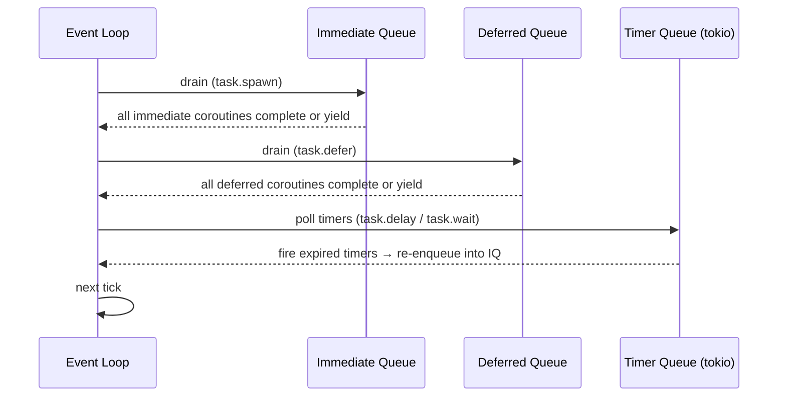

# 0005 — std:task — cooperative task scheduler

> [!NOTE]
> This RFC is `proposed`. Under review — pending seeker sign-off before implementation.

## Summary

`std:task` — canonical cooperative scheduler for neoc. Exposes five primitives matching Roblox `task` library exactly: `spawn`, `defer`, `delay`, `wait`, `cancel`. Backed by tokio async runtime; yields never block OS threads. Strictly intra-worker: operates on coroutines within a single Lua VM, orthogonal to cross-VM `std:thread`. `task.spawn` returns a `Task` UserData handle (mirrors tokio `JoinHandle`) with `:cancel()`, `:is_finished()`, and `:await()` methods — the dual-API pattern from the design principles. The flat `task.cancel(handle)` function is retained for Roblox muscle-memory compatibility.

## Motivation

Luau ecosystem has one concurrency mental model: `task` library. Roblox ships it built-in; Lune ships a 1:1 port; Lute too. Not one option among many — the idiomatic primitive, like `goroutine`+`chan` for Go or `Promise`+`async/await` for JS.

Without `std:task`: raw coroutines + `os.clock` busy-waiting. Unacceptable for a runtime targeting Roblox/Lune ecosystem (issue #6). Breaks portability — Lune code requires rewriting every async call site.

`std:thread` handles OS-thread-level workers (separate Lua VMs). `std:task` is the complementary primitive: lightweight coroutine fan-out within a single VM, no OS-thread overhead, event-loop-integrated timing.

## Detailed design

### Design tenets

1. **Roblox compatibility is north star.** Five-function surface matches Roblox `task` exactly. Deviation requires specific justification; "our own design" is not one.
2. **No OS-thread blocking.** Every yield suspends a coroutine and parks a tokio future.
3. **Per-worker scheduler.** Each Lua VM runs its own scheduler. No global cross-VM scheduler.
4. **tokio drives timing.** `delay`/`wait` use `tokio::time::sleep`, not busy-loops.
5. **Error isolation.** Errors in spawned coroutines do not propagate to spawner. Reported to stderr, coroutine cleaned up.

### Lua surface

```lua
local task = require("std:task")

-- spawn: resume fn immediately on the current thread; runs until fn first yields or returns,
-- then control returns to the caller. Caller is NOT suspended.
-- Returns a Task UserData handle. Any extra args are passed to fn.
local handle = task.spawn(function(x)
    print("runs now, x =", x)
end, 42)

-- defer: queue fn to resume after the current scheduler cycle completes.
-- Returns a Task handle. Any extra args are passed to fn.
local h2 = task.defer(function()
    print("runs after this cycle")
end)

-- delay: schedule fn to resume after `secs` seconds (tokio-backed, not busy-wait).
-- Returns a Task handle. Extra args after fn are forwarded to fn.
local h3 = task.delay(2.5, function()
    print("runs ~2.5s from now")
end)

-- wait: yield the *current* coroutine for `secs` seconds.
-- Must be called from a coroutine context; errors if called from the main thread.
-- Negative values are clamped to 0. Returns elapsed time as a float.
local elapsed = task.wait(1.0)

-- cancel: flat function for Roblox compat (delegates to handle:cancel())
task.cancel(h3)

-- Task handle methods (neoc extension — dual-API pattern)
handle:cancel()          -- cancel the task
handle:is_finished()     -- query completion state
local result = handle:await()  -- yield until task completes; returns result or (nil, err)
```

#### Argument passing

`spawn`, `defer`, `delay` accept variadic args after the function, forwarded on resume. Matches Roblox:

```lua
task.spawn(function(a, b, c)
    print(a, b, c)   -- → 1  2  3
end, 1, 2, 3)
```

#### `task.wait` return value

Returns elapsed real time as float. Callers may compensate for scheduler jitter. Negative `secs` clamped to `0` (Roblox-compatible); `task.wait(-1)` ≡ `task.wait(0)`.

```lua
local dt = task.wait(0.016)   -- target ~60 fps frame budget
```

#### Error behaviour

Coroutine errors do not crash scheduler. Error reported via runtime error channel (same path as `std:io`), coroutine dropped. Other in-flight coroutines unaffected. Matches Roblox:

```lua
task.spawn(function()
    error("boom")
    -- ^ logged to stderr; other coroutines keep running
end)
task.wait(0.1)  -- yield to next tick; scheduler continues
```

### Scheduler semantics

Two phases per event-loop tick:

1. **Immediate queue** — `spawn` coroutines. Drained FIFO before advancing event loop.
2. **Deferred queue** — `defer` coroutines. Drained after immediate queue empties.

`delay`/`wait` → tokio `sleep` futures wired into event loop; do not participate in immediate/deferred queues until timer fires.



Canonical Roblox scheduler design (Immediate → Deferred → Heartbeat → signals). neoc collapses heartbeat phases (no meaning outside game engine) but preserves Immediate/Deferred distinction — observable to Luau code.

#### `task.delay(0)` semantics

`task.delay(0, fn)` is equivalent to `task.defer(fn)` — both enqueue into the deferred queue. When a zero-duration timer fires, the callback is placed at the back of the deferred queue for the current tick, not the immediate queue. This matches Roblox behaviour where `delay(0)` runs on the next resumption cycle (heartbeat), semantically identical to `defer`.

Observable ordering guarantee: given `task.delay(0, f1)` followed by `task.defer(f2)` in the same execution slice, `f1` runs before `f2` (FIFO within the deferred queue — `f1` was enqueued first).

```lua
-- These two are semantically equivalent:
task.delay(0, fn)
task.defer(fn)

-- Observable ordering:
task.delay(0, function() print("A") end)
task.defer(function() print("B") end)
-- Output: A, B (FIFO within deferred queue)
```

### Task handle (UserData)

`task.spawn` returns a `Task` UserData — a handle to the scheduled coroutine, mirroring tokio's `JoinHandle<T>`. This is the dual-API pattern from the design principles: principle 3 (mirror Rust) provides the UserData with lifecycle methods; principle 4 (scripting ergonomics) provides the flat `task.cancel(handle)` for Roblox muscle-memory.

`task.defer` and `task.delay` also return `Task` handles.

#### Methods

```lua
handle:cancel()        -- cancel the task; returns true if cancelled, false if already completed
handle:is_finished()   -- returns true if the task completed (success or error) or was cancelled
handle:await()         -- yield current coroutine until task completes;
                       -- returns task result on success, or (nil, err) on error/cancellation
```

#### `handle:await()` semantics

`handle:await()` is a neoc extension beyond the Roblox surface (Roblox has no per-task join). It fills a real gap: "wait until this specific task finishes" — distinct from `task.wait(n)` which sleeps for a fixed duration.

- Yields the current coroutine (does not block the executor).
- On success: returns the task's return values.
- On error: returns `(nil, error_message)` where `error_message` is a string. (Interim format — type may change when the error format RFC lands per open question #1.)
- On cancellation: returns `(nil, "cancelled")`.
- Calling `:await()` on an already-completed task returns immediately with the cached result.
- Calling `:await()` on a cancelled task returns immediately with `(nil, "cancelled")`.
- **Single-consumer:** at most one coroutine may be suspended in `:await()` on a given handle at a time. A second call to `:await()` while another coroutine is already waiting → error `"task.await: another coroutine is already awaiting this task"`. Sequential re-calls after completion are fine (cached result). Mirrors tokio `JoinHandle` (single-consumer; second `.await` panics).
- **Self-await detection:** calling `handle:await()` from within the task itself → error `"task.await: cannot await self"`. This is a guaranteed deadlock (task yields waiting for its own completion); detected at call site.

```lua
local handle = task.spawn(function()
    task.wait(1)
    return "done", 42
end)

-- ... do other work ...

local a, b = handle:await()   -- yields until spawn completes; a="done", b=42
```

#### Cancellation semantics

The cancellation state machine has three cases depending on task state at cancel time:

**Case 1: Task is yielded/suspended (in scheduler queues).** Straightforward — task is removed from the queue and marked cancelled. `:await()` returns `(nil, "cancelled")` immediately.

**Case 2: Task is suspended inside `task.wait(n)` (timer-backed, not in scheduler queues).** Cancellation is prompt — the tokio timer is cancelled and the task returns immediately with cancelled status. Does not wait for the timer to fire. Mirrors `tokio::JoinHandle::abort()` — cancellation latency is not bounded by remaining sleep duration.

```lua
local h = task.spawn(function() task.wait(60) end)  -- suspended on 60s timer
h:cancel()             -- wakes immediately; does not wait 60s
h:is_finished()        -- → true
local ok, err = h:await()  -- → nil, "cancelled"
```

**Case 3: Task is mid-execution (running its current slice).** Cancel marks the task; execution continues until the current slice yields or returns. After yield/return, the task is not re-enqueued. This applies identically whether cancel is called from another coroutine or from the task itself (self-cancel).

**Self-cancel:** `handle:cancel()` called from within the task's own execution is a deferred cancel — the task continues its current slice, and after yield/return it is discarded. Matches Roblox where `task.cancel` on a running coroutine is effectively a no-op until yield.

```lua
local handle
handle = task.spawn(function()
    handle:cancel()        -- marks cancelled; execution continues
    print("still runs")   -- this prints
    task.wait(1)           -- yields → task discarded, never re-enqueued
    print("never runs")
end)
```

**`is_finished()` during cancel-while-running:** returns `false` until the execution slice actually completes. `is_finished()` reflects execution state, not mark state. Once the slice yields/returns and the task is discarded, `is_finished()` returns `true`.

#### Roblox/Lune cancel-while-running comparison

In Roblox, `task.cancel()` on a currently-running coroutine is a no-op — cancellation only applies to yielded/suspended threads. The running thread continues unaffected; the cancel call returns `false`. Lune follows identical behaviour.

neoc diverges deliberately: cancellation marks the task regardless of execution state. A running task completes its current slice, then is discarded at the next yield point. This is more useful than "no-op on running" — it provides a reliable cancellation mechanism where the caller can guarantee the task won't run beyond its current slice. The divergence is acceptable because: (1) Roblox scripts rarely cancel running tasks (it's a no-op there, so nobody writes code relying on it), and (2) the observable difference is only visible at the next yield, not mid-statement.

#### Flat cancel function (Roblox compatibility)

`task.cancel(handle)` delegates to `handle:cancel()`. Exists purely for Roblox muscle-memory — developers expect the flat form.

```lua
task.cancel(handle)   -- equivalent to handle:cancel()
```

#### Input validation

`task.spawn`/`task.defer` accept a plain function **or** a coroutine created by `coroutine.create`. When a raw coroutine is passed, the scheduler registers it on entry and wraps it in a `Task` handle.

Passing `dead` or `running` coroutine → error:
- `"task.spawn: cannot schedule a dead coroutine"`
- `"task.spawn: cannot schedule a running coroutine"`
- Substitute `task.defer` when raised from that function.

`task.cancel` on a value that is not a `Task` handle → type error.

```lua
-- spawn returns a Task handle
local h = task.spawn(f)
h:cancel()               -- → true
h:is_finished()          -- → true (cancelled counts as finished)

-- defer handle is equally cancellable
local h2 = task.defer(f)
task.cancel(h2)          -- → true (flat form)

-- pre-created coroutine gets wrapped in a Task handle
local c = coroutine.create(f)
local h3 = task.spawn(c)
h3:is_finished()         -- → false (still running/pending)

-- completed task: cancel is a no-op
local h4 = task.spawn(function() end)   -- completes immediately
h4:cancel()              -- → false (already done)
h4:is_finished()         -- → true

-- await after cancel
local h5 = task.spawn(function() task.wait(10) end)
h5:cancel()
local ok, err = h5:await()   -- → nil, "cancelled"

-- type error: not a Task handle
task.cancel(42)          -- → error: "task.cancel: expected Task, got number"
task.cancel(nil)         -- → error: "task.cancel: expected Task, got nil"
```

### Relationship to `std:thread`

| Dimension | `std:thread` | `std:task` |
|---|---|---|
| Concurrency model | OS-level workers (separate Lua VMs) | Cooperative coroutines (single VM) |
| Communication | `Channel` (`thread.parent`, message-passing) | Shared coroutine scheduler |
| Shared state | `Sendable` + spawn-time handoff | Local — no cross-coroutine isolation needed |
| When to use | CPU-bound parallelism, isolation | I/O-bound concurrency, Roblox-style game loops |

### Rust-side layout

```
src/lua/std/
  task.rs    -- task.spawn, task.defer, task.delay, task.wait, task.cancel
              -- + Scheduler struct, Task UserData
```

`Scheduler` held on Lua VM state via `set_app_data` → per-VM, no global state. Each `task.*` pulls scheduler from VM app data, never accessed across threads.

```rust
// src/lua/std/task.rs (sketch — not the implementation contract)

struct TaskState {
    status: TaskStatus,          // Pending | Running | Completed | Cancelled
    result: Option<Vec<Value>>,  // cached return values (or error)
    awaiter: Option<mlua::Thread>, // at most one suspended awaiter (single-consumer)
    awaited: bool,               // true if any caller observed the error via :await()
}

struct TaskHandle {
    id: TaskId,
    state: Rc<RefCell<TaskState>>,
}

impl UserData for TaskHandle {
    fn add_methods<M: UserDataMethods<Self>>(methods: &mut M) {
        methods.add_method("cancel", |_, this, ()| { ... });
        methods.add_method("is_finished", |_, this, ()| { ... });
        methods.add_async_method("await", |lua, this, ()| {
            // Error if self-await (this.id == current task id)
            // Error if awaiter already set (single-consumer)
            ...
        });
    }
}

struct Scheduler {
    immediate: VecDeque<(TaskId, mlua::Thread, Vec<mlua::Value>)>,
    deferred:  VecDeque<(TaskId, mlua::Thread, Vec<mlua::Value>)>,
    tasks: HashMap<TaskId, Rc<RefCell<TaskState>>>,
    // timer handles are owned by tokio and re-enqueue into `immediate` on fire
}
```

`Rc<RefCell<TaskState>>` is correct because the scheduler is per-VM and `Lua` is not `Send`. No `Arc` needed.

#### Task state cleanup (GC policy)

`TaskHandle` implements a Lua `__gc` metamethod (finalizer). Cleanup contract:

- When a `TaskHandle` is garbage-collected **and** the task is complete (success, error, or cancelled): the corresponding entry is removed from `Scheduler.tasks`.
- Active tasks (pending/running) retain their entry regardless of handle GC — the scheduler owns the reference via the queue.
- This bounds memory growth to: active tasks + handles still reachable in Lua. Fire-and-forget spawns with discarded handles are cleaned up promptly after completion + next GC cycle.

```rust
impl UserData for TaskHandle {
    fn add_fields<F: UserDataFields<Self>>(fields: &mut F) {
        fields.add_meta_method(MetaMethod::Gc, |lua, this, ()| {
            // If task is complete, remove from scheduler.tasks
            ...
        });
    }
}
```

### Acceptance criteria

#### API surface

- [ ] `task.spawn(fn | thread, ...)` — resume immediately; pass varargs; return `Task` UserData handle.
- [ ] `task.defer(fn | thread, ...)` — queue to end of cycle; pass varargs; return `Task` handle.
- [ ] `task.delay(secs, fn, ...)` — schedule after `secs` (tokio-backed); pass varargs; return `Task` handle.
- [ ] `task.wait(secs)` — yield current coroutine for `secs`; return elapsed float.
- [ ] `task.cancel(handle)` — flat function; delegates to `handle:cancel()`; Roblox-compatible signature.

#### Task UserData

- [ ] `handle:cancel()` — return `true` if cancelled, `false` if already completed (no-op).
- [ ] `handle:is_finished()` — return `true` if task completed (success, error, or cancelled).
- [ ] `handle:await()` — yield current coroutine until task completes; return task result on success, `(nil, err)` on error, `(nil, "cancelled")` on cancellation. `err` is a string (error message) until the error format RFC resolves open question #1.
- [ ] `handle:await()` on already-completed task returns immediately (cached result).
- [ ] `handle:cancel()` then `handle:await()` returns `(nil, "cancelled")`.
- [ ] `handle:await()` single-consumer: second concurrent awaiter → error `"task.await: another coroutine is already awaiting this task"`.
- [ ] `handle:await()` self-await detection → error `"task.await: cannot await self"`.
- [ ] `TaskHandle` implements `__gc`: removes entry from `Scheduler.tasks` when handle is GC'd and task is complete.

#### Varargs

- [ ] `task.spawn(fn, ...)` forwards varargs correctly: 0, 1, N args.
- [ ] Varargs with nil holes (`spawn(fn, 1, nil, 3)`) preserves count.
- [ ] `task.defer` and `task.delay` forward varargs identically.

#### Input validation

- [ ] `task.spawn`/`task.defer` on `dead` coroutine → error `"task.spawn: cannot schedule a dead coroutine"` (or `task.defer` variant).
- [ ] `task.spawn`/`task.defer` on `running` coroutine → error `"task.spawn: cannot schedule a running coroutine"` (or `task.defer` variant).
- [ ] `task.cancel(nil)` → type error.
- [ ] `task.cancel(non_task)` → type error.
- [ ] `task.wait` from main thread → immediate error.
- [ ] `task.wait` negative duration → clamped to 0.

#### Timing

- [ ] `task.wait(0)` yields to next event-loop tick (Roblox-compatible).
- [ ] `task.delay(0, fn)` equivalent to `task.defer(fn)` — enqueues into deferred queue (Roblox-compatible).
- [ ] `task.delay(0, f1)` then `task.defer(f2)` in same slice → `f1` runs before `f2` (FIFO).
- [ ] `task.wait` never blocks OS thread (tokio sleep).
- [ ] Timing tests assert `elapsed >= requested`; upper-bound tolerance 100ms (CI jitter budget), documented in spec.

#### Error isolation

- [ ] Errors in spawned coroutines isolated — logged to stderr, not propagated to caller.
- [ ] Script exit code non-zero if any spawned task errored **and was not awaited**. A task whose error is observed via `:await()` is considered handled — does not contribute to non-zero exit. Mirrors tokio: panics that are `.join()`ed and handled don't propagate.
- [ ] Scheduler per-VM; no global state.

#### Cancellation

- [ ] `task.cancel` on completed task → `false` (no-op, no error).
- [ ] `task.cancel` on already-cancelled task → idempotent (returns `false`).
- [ ] `task.cancel` on mid-execution coroutine → marks cancelled; not re-enqueued after next yield. Cancellation not immediate — completes current execution slice.
- [ ] `task.cancel` on timer-suspended task (`task.wait(n)`) → prompt cancellation. Timer cancelled, task marked finished immediately.
- [ ] Self-cancel (`handle:cancel()` from within the task) → deferred cancel; task continues current slice, discarded at next yield/return.
- [ ] `handle:is_finished()` during cancel-while-running slice → `false` (reflects execution state, not mark state).

#### Deliverables

- [ ] Type definition stub (`.d.luau`) at `types/std/task.d.luau`.
- [ ] Spec at `tests/std/task.spec.lua` using `lib:test`, committed before implementation PR (see [RFC 0000](0000-spec-driven-development.md)).
- [ ] Full test suite covering test matrix in issue #2.

## Drawbacks

- Five exported functions + one UserData type to maintain. API surface stable (Roblox constrains the flat functions), but scheduler + Task handle state machine is non-trivial Rust.
- `Task` UserData is a neoc extension — code using `:await()` or `:is_finished()` is not portable back to Roblox/Lune. Mitigation: the flat API (`task.spawn`, `task.cancel`) remains 1:1 Roblox-compatible; extensions are additive.
- Immediate/Deferred ordering observable to scripts → coupling to scheduler internals. Inherent to Roblox model; acceptable because explicitly documented.
- No cap on live coroutines. Scripts can saturate immediate queue. Consistent with Roblox/Lune — follow pattern rather than diverge.

## Alternatives

### Do nothing / raw coroutines

`coroutine.create` + `coroutine.resume` available today. Forces manual scheduling, manual error handling, OS-clock polling for timers. Wrong default for Lua developers. Rejected.

### `task.wait` as blocking (busy-wait)

Simpler — `std::thread::sleep`. Blocks OS thread for entire duration → kills concurrency model. 100 coroutines sleeping 1s → serialised. Rejected (principles 1+2: surprises + footgun).

### Single global scheduler across all VMs

Share one scheduler across `std:thread` workers. Eliminates per-worker overhead but requires `Send + Sync` + lock contention. Roblox explicitly does not share schedulers across workers. Rejected — stay consistent with per-worker model.

### Expose `desynchronize`/`synchronize` (Roblox parallel Luau)

Roblox parallel Luau: `task.desynchronize()` yields out of serialised actor context, `task.synchronize()` re-enters. Meaningful in Roblox because actors have write-isolation. neoc uses `std:thread` (separate VMs), not actor isolation → these map to nothing. Excluded; revisit if neoc introduces actor-style isolation.

### Return plain thread instead of Task UserData

Return Lua `thread` (coroutine) values from `task.spawn` — matching Roblox exactly. No custom UserData. Simpler implementation — but loses join semantics (`await`), completion queries (`is_finished`), and type-safe cancel. Roblox doesn't need these because it has engine-level lifetime management; neoc scripts are standalone and need explicit coordination. The dual-API pattern (UserData + flat functions) gives both Roblox compat and Rust-style lifecycle management. Rejected in favour of TaskHandle.

**Compatibility note:** Roblox returns the thread itself from `task.spawn` — `type(task.spawn(f)) == "thread"`. In neoc, `type(task.spawn(f)) == "userdata"`. Scripts that check `type(handle) == "thread"` are not portable from Roblox. This is accepted — `type(handle)` checks are rare in practice and the flat API (`task.cancel(handle)`) works identically regardless of the underlying type.

### Combine with `std:thread`

Put `task.spawn` et al. on `std:thread` module. Rejected — concerns are distinct: `std:thread.spawn` creates new VM; `task.spawn` schedules coroutine inside current VM. Mixing blurs abstraction boundary, confuses Roblox users (separate globals). Separation keeps both modules independently comprehensible.

## Open questions

1. **Error format for throwing coroutine?** Message, stack trace, coroutine identity — needs consistent format across all runtime error surfaces. Tracks with `std:io` error formatting work. **Cross-track dependency:** cannot pin exact error string in acceptance criteria until std:io error formatting design decided. Implementation PR gated on that design (or temporary format recorded in ADR). **Interim:** `err` returned from `:await()` is a plain string (error message). Type may change when error RFC lands.

2. ~~**Should `task.wait(0)` be legal?**~~ **Resolved.** Legal. Yields until next event-loop tick (Roblox-consistent). Captured in acceptance criteria.

3. ~~**Cancellation semantics for running coroutine.**~~ **Resolved.** Option (b) — mark cancelled, next yield detects flag, not re-enqueued. Avoids closing mid-frame. Captured in acceptance criteria.

4. ~~**`delay(0)` semantics.**~~ **Resolved.** Equivalent to `task.defer` — enqueues into deferred queue. FIFO ordering within the queue. Captured in acceptance criteria.

5. ~~**Self-cancel behaviour.**~~ **Resolved.** Deferred cancel — task continues current slice, discarded at next yield/return. Matches the general cancel-while-running semantics. Captured in acceptance criteria.

6. ~~**Multiple concurrent awaiters.**~~ **Resolved.** Single-consumer. Second live await errors. Mirrors tokio `JoinHandle`. Cached result available for sequential re-calls after completion. Captured in acceptance criteria.

7. ~~**Exit code for caught errors.**~~ **Resolved.** "Errored AND not awaited" — if `:await()` observes the error, it's handled and does not contribute to non-zero exit. Captured in acceptance criteria.

8. ~~**`Scheduler.tasks` cleanup policy.**~~ **Resolved.** `TaskHandle.__gc` removes entry from scheduler map when handle is GC'd and task is complete. Captured in Rust sketch and acceptance criteria.

9. ~~**Cancellation of timer-suspended tasks.**~~ **Resolved.** Prompt cancellation — timer cancelled, task returns immediately with cancelled status. Mirrors `tokio::JoinHandle::abort()`. Captured in acceptance criteria.

## Implementation notes

- Register `Scheduler` on Lua VM via `lua.set_app_data(Scheduler::new())` during engine construction in `src/lua/sandbox.rs`.
- `task.wait` requires calling coroutine running inside scheduler; from main thread → immediate error (spec must cover).
- tokio timer integration in `task.delay`/`task.wait` — same pattern as TCP accept loop in `std:net`: spawn `tokio::task` that fires wakeup into scheduler queue. No new tokio primitives.
- Depends on tokio runtime being available (engine already requires it — see `sandbox.rs` `make_engine`).
- `.d.luau` type stub at `types/std/task.d.luau` alongside other module stubs.
